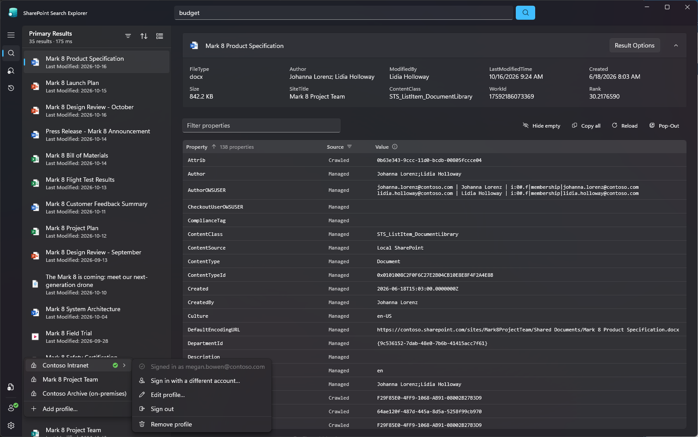

# SharePoint Search Explorer
This application is a reimplementation of the [SharePoint Search Query Tool (SSQT)](https://github.com/pnp/PnP-Tools/tree/master/Solutions/SharePoint.Search.QueryTool) in C# using the WinUI 3. <BR>

> [!IMPORTANT]
> **Disclaimer:** This application was built with AI-generated code. If you prefer not to use AI-generated software, please do not proceed. 

## About
In my day-to-day work with SharePoint, I very frequently use the venerable [SharePoint Search Query Tool (SSQT)](https://github.com/pnp/PnP-Tools/tree/master/Solutions/SharePoint.Search.QueryTool). However, I recently started to have issues that caused friction when using the application. Namely, I had to sign-in each time I needed to run a query, and the properties windows would often quit unexpexctedly. I've been dabling with vibecoding certain utilities for my document management needs, so I figured I would try supervising a rebuild of a new version of the SSQT. SharePoint Search Explorer is the result of that effort. 

### Project Goals
- Focus the user experience around result properties. While I'm sure that there are a lot of users who focus on diving into payload code and writing their own custom advanced queries, this is not my focus for using the app. Therefore I have prioritized quickly searching for items and displaying their crawled and managed properties. As such, I have hidden the majority of the Power User/Advanced type features by default. 
- Modernize the UI to use the WinUI 3 framework. This would be done to bring the application into cadence with current Windows 11 look and feel. This also offers additional customization and themeing which is always nice to have. 
- Create user experience improvements such as easy filtering of search results, searching for properties, and build-in often used links like navigating to the result parent location, etc. 
- Allow users to create multiple tenant profiles. 
- Keeping sign-in persistent between sessions.
- Application should be portable without any installation required. 
<BR><BR>

## Updates
**Settings › About › Check for updates** (and, unless turned off, every start) asks GitHub for the latest release of
[dontthroworanges/SharePointSearchExplorer](https://github.com/dontthroworanges/SharePointSearchExplorer). If its
tag (e.g. `v1.1.0`) is newer than the app's `<Version>`, the release's `.exe` is downloaded in the background to
`%LOCALAPPDATA%\SharePointSearchExplorer\Updates`, checked against GitHub's SHA-256 digest, and offered for install.
Installing renames the running `.exe` to `.exe.old`, puts the new one in its place and restarts; the next start removes
the `.old` file. If the app's folder needs admin rights, Windows asks for them.

To publish a release, bump `<Version>` in the csproj, then publish the single-file `.exe` (also the VS Code `publish`
task):

```
dotnet publish SharePointSearchExplorer/SharePointSearchExplorer.csproj -c Release -r win-x64 --self-contained true -p:PublishSingleFile=true -p:IncludeNativeLibrariesForSelfExtract=true -p:EnableCompressionInSingleFile=true -o publish/win-x64
```

This produces `publish/win-x64/SharePointSearchExplorer.exe`. Attach it to a GitHub release tagged `v<Version>`
(drafts and pre-releases are ignored), keeping its file name: an update saves the new `.exe` under the release file's
name, in place of the running one. If you publish more than one architecture, include `x64`, `x86` or `arm64` in each
asset's name.

## Install options
The app is a single portable `.exe` that runs from any folder, with nothing to install. To add it to the Start menu,
turn on **Settings › About › Show in the Start menu**. This creates a shortcut for your account only, without admin
rights. The app keeps the shortcut pointing at itself after it updates or moves. Don't rename the `.exe`: a WinUI app
finds its resources by its own file name.
